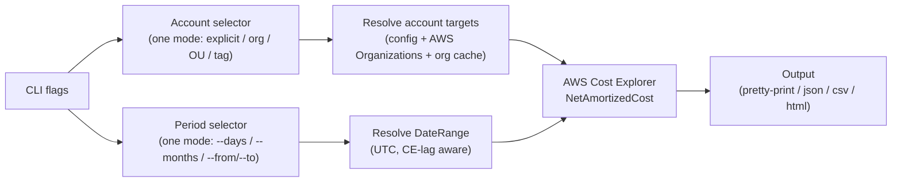
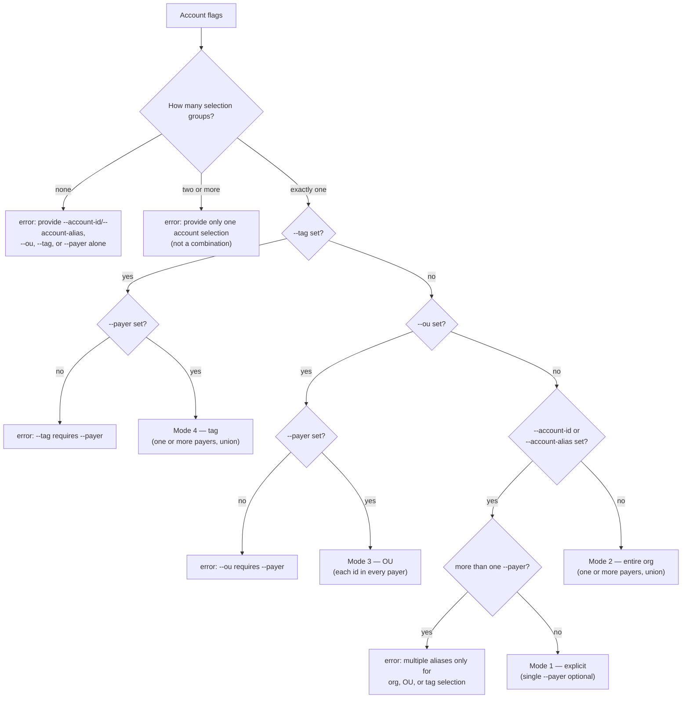
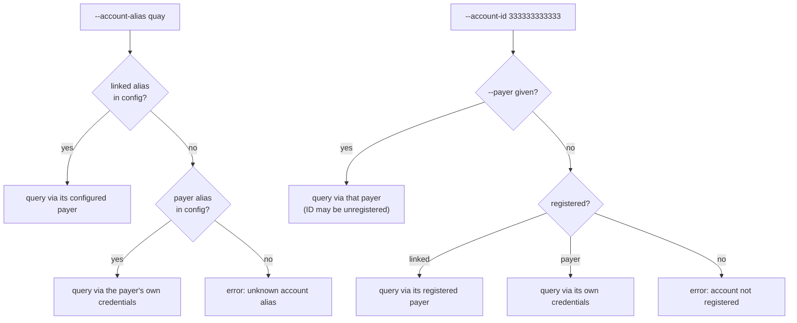
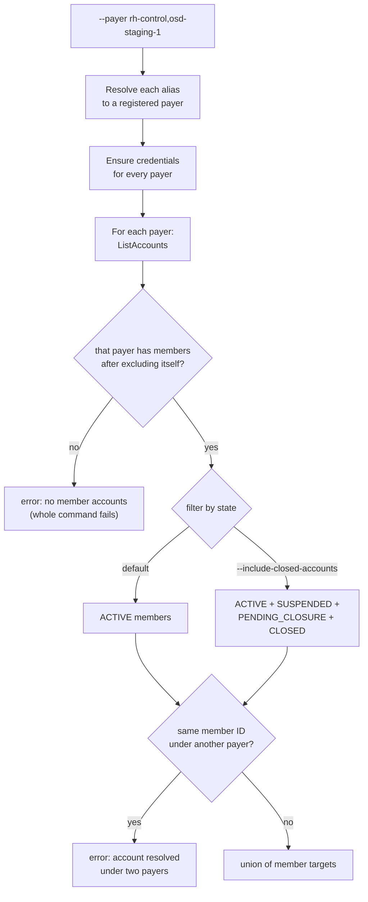
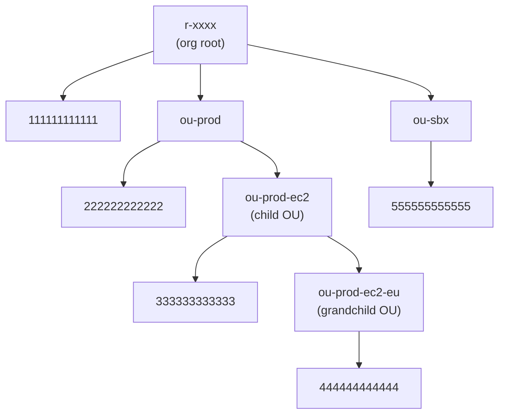
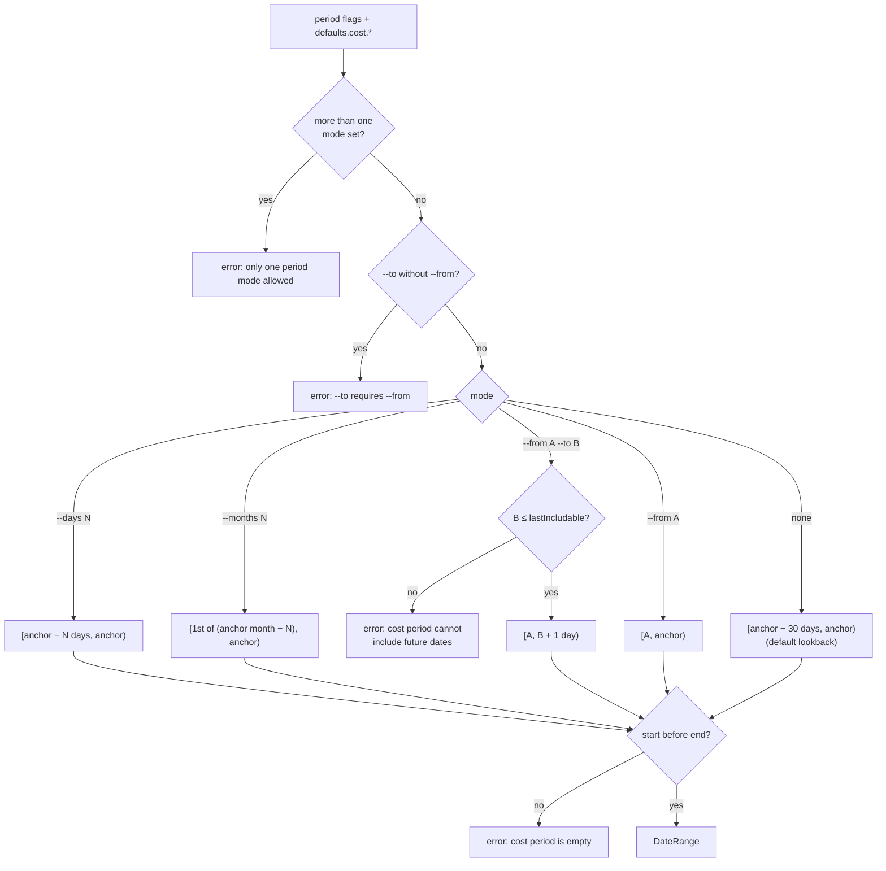

# Query selectors: accounts and time periods

Every cost query in finops is parameterized along two independent dimensions:

1. **Account selection** — *which* AWS accounts the query covers
2. **Time selection** — *which* date range the query covers



The two dimensions are orthogonal: any account selection can be combined with any
period. Both are validated **before** any AWS API call is made, so an invalid
combination fails fast with a clear error.

The **account selection** dimension is shared by `finops account get-cost`,
`finops report create`, `finops snapshot list`, `finops account details`, and
`finops extended-support list`.
A few scoping caveats: the `hcp-hierarchy` report template is Snowflake-based
(`--snowflake-alias`) and rejects AWS selector flags, `finops snapshot list`
uses an `--older-than-days` age cutoff instead of a period window, and
`finops extended-support list` with `--payer` alone further keeps only members
that have Extended Support billing in the lookback window unless `--full-scan`
is set. The **time selection** dimension applies to the cost query commands
only. See the [command matrix](#command-matrix) for per-command differences.

---

## Account selection

### The four modes

Account selection uses **exactly one mode**. The flag groups below are mutually
exclusive — combining flags from two groups is an error. `--payer` is special:
it is a *qualifier* required by the OU and tag modes (and optionally used by the
explicit mode), and it only becomes a selection mode on its own. The flag
accepts one or more comma-separated aliases. Several aliases are unioned for
org, OU, and tag selection; explicit accounts allow at most one. See
[Multiple payers](#multiple-payers).

| # | Mode | Flags | What gets selected |
|---|------|-------|--------------------|
| 1 | Explicit | `--account-id` and/or `--account-alias` (optional single `--payer`) | The exact accounts you name |
| 2 | Entire org | `--payer` alone (one or more aliases) | Member accounts in each listed payer's AWS Organization (each payer itself excluded) |
| 3 | OU / org-root | `--payer --ou <ids>` | Accounts under an OU or org root, resolved in every listed payer, with per-ID scope control |
| 4 | Tag | `--payer --tag KEY[=VALUE]` | Org accounts carrying a given AWS Organizations tag, matched in every listed payer |

Mode resolution follows this decision flow:



The full combination matrix (✓ = flag provided):

| `--account-id` / `--account-alias` | `--ou` | `--tag` | `--payer` | Result |
|:---:|:---:|:---:|:---:|---|
| ✓ | · | · | · | Mode 1 — explicit |
| ✓ | · | · | ✓ | Mode 1 — explicit (`--payer` supplies Cost Explorer credentials for unregistered member IDs) |
| · | ✓ | · | ✓ | Mode 3 — OU |
| · | · | ✓ | ✓ | Mode 4 — tag |
| · | · | · | ✓ | Mode 2 — entire org |
| · | ✓ | · | · | ✗ error: `--ou requires --payer` |
| · | · | ✓ | · | ✗ error: `--tag requires --payer` |
| ✓ | ✓ | · | ✓ | ✗ error: mixed selection |
| ✓ | · | ✓ | · | ✗ error: mixed selection |
| · | ✓ | ✓ | ✓ | ✗ error: mixed selection |
| · | · | · | · | ✗ error: no selection provided |
| · | · | · | 2+ | Mode 2 — union of those organizations |
| · | ✓ | · | 2+ | Mode 3 — each OU id resolved in every payer |
| · | · | ✓ | 2+ | Mode 4 — tag matched in every payer |
| ✓ | · | · | 2+ | ✗ error: `--payer accepts multiple aliases only for org, OU, or tag selection` |

`2+` means two or more comma-separated `--payer` aliases. A single alias is `✓`.

### Multiple payers

`--payer` takes a comma-separated list of registered payer aliases
(`rh-control,osd-staging-1`). Entries are trimmed, empty entries are dropped,
and duplicate aliases are ignored. Two aliases that resolve to the same payer
account are queried once, keeping the first alias.

| Selection | Several `--payer` aliases |
|-----------|---------------------------|
| `--payer` alone | Allowed. Union of each organization's members |
| `--payer` + `--ou` | Allowed. Each OU or org-root id is resolved in every listed payer |
| `--payer` + `--tag` | Allowed. The tag is matched in every listed payer |
| `--account-id` / `--account-alias` | Rejected. Explicit selection accepts at most one `--payer` |

```bash
# Allowed — members of both organizations
finops account get-cost --payer rh-control,osd-staging-1

# Rejected — explicit accounts accept a single --payer
finops account get-cost --payer rh-control,osd-staging-1 --account-id 333333333333
```

Shared rules for the three modes that accept a list:

1. Each alias must be a registered payer. An unknown alias fails before any AWS call.
2. Credentials are ensured for every payer, then each payer is queried in the order given.
3. Results are unioned. The same member account ID returned by two different payers is an error (`account <id> resolved under payers <alias-a> and <alias-b>`), not a silent merge.
4. A failure against any one payer fails the whole command and names that payer (`<alias> (<account-id>)`).
5. On `get-cost` and `report create`, `--group-by ou` with several payers keeps a separate tree per payer, each starting at that organization's root. With one payer and exactly one `--ou` id, that id is the tree root; otherwise a single payer rolls up from its organization root.

`finops tag` and `finops aws list-ous` take a single `--payer`. Comma-separated aliases apply to `account get-cost`, `report create`, `snapshot list`, `account details`, and `extended-support list`.

### Mode 1 — Explicit accounts

Select accounts by name: raw 12-digit AWS account IDs and/or locally configured
aliases. This is the only mode where the account set is fixed at the command
line and no AWS Organizations API call is needed to enumerate targets.

| Flag | Accepts | Registration requirement |
|------|---------|--------------------------|
| `--account-id` | One or more comma-separated 12-digit AWS account IDs | Must be registered in the finops config — *unless* a single `--payer` is also given, in which case member IDs may be unregistered |
| `--account-alias` | One or more comma-separated configured aliases (payer aliases such as `rh-control`, or linked aliases such as `quay`) | Alias must exist in the finops config |

How each target's **Cost Explorer credentials** are routed:



Duplicate IDs and aliases that resolve to the same account are deduplicated.
More than one `--payer` alias in this mode is an error; use one alias when the
IDs are unregistered, or omit `--payer` when every account is already registered.

```bash
# One registered account by alias (payer or linked)
finops account get-cost --account-alias rh-control

# Multiple aliases (comma-separated)
finops account get-cost --account-alias rh-control,osd-staging-1

# Raw account IDs
finops account get-cost --account-id 123456789012
finops account get-cost --account-id 123456789012,111111111111

# Unregistered member IDs, queried through a registered payer's Cost Explorer
finops account get-cost --payer rh-control --account-id 333333333333
```

### Mode 2 — Entire organization

`--payer <aliases>` **alone** selects every member account in each listed
payer's AWS Organization. One alias is the common case; several aliases union
those organizations. See [Multiple payers](#multiple-payers).

For each payer, in order:

1. The alias is resolved to a registered payer account ID.
2. Payer credentials are ensured (SAML or profile).
3. Organization member accounts are listed via AWS Organizations.
4. That payer/management account itself is **excluded** from its member list.
5. Members are appended to the union. The same account ID from a later payer is an error.

A payer with no members after that exclusion fails the whole command
(`no active member accounts found in organization`, or `no member accounts found
in organization` when `--include-closed-accounts` is set). One empty organization
among several does not get skipped.



```bash
# All active members in one organization
finops account get-cost --payer rh-control

# Active members of two organizations, unioned
finops account get-cost --payer rh-control,osd-staging-1

# Include closed/suspended members too (get-cost only)
finops account get-cost --payer rh-control --include-closed-accounts

# One org, rolled up by organizational unit
finops account get-cost --payer rh-control --group-by ou
```

### Mode 3 — OU / org-root selection

`--payer` (one or more aliases) plus one or more comma-separated OU
(`ou-xxxx-yyyyy`) or org-root (`r-xxxx`) IDs. Each ID accepts an optional
**scope suffix** that controls how deep the OU tree is walked:

| `--ou` value | Walk depth | Meaning |
|--------------|-----------|---------|
| `ou-xxxx` (bare) | unbounded | All accounts in the OU **and every descendant OU** (default) |
| `ou-xxxx/**` | unbounded | Same as the bare ID (explicit subtree) |
| `ou-xxxx/*` | 1 | Accounts in the OU **plus its immediate child OUs only** |
| `ou-xxxx/` | 0 | Accounts **directly** in the OU only (no child OUs) |

Org-root IDs (`r-xxxx`) accept the same suffixes.

The effect of each suffix on a sample organization tree:



| Selector | Accounts selected |
|----------|-------------------|
| `--ou ou-prod` (or `ou-prod/**`) | `222222222222`, `333333333333`, `444444444444` — entire subtree |
| `--ou ou-prod/` | `222222222222` — direct members only |
| `--ou ou-prod/*` | `222222222222`, `333333333333` — OU + immediate child OUs (grandchild OU not walked) |
| `--ou r-xxxx` (or `r-xxxx/**`) | `111111111111` plus every account under every root-level OU (whole org subtree) |
| `--ou r-xxxx/` | `111111111111` — accounts directly under the org root only |
| `--ou r-xxxx/*` | `111111111111`, `222222222222`, `555555555555` — root + one OU level down |

Notes:

- Multiple OUs are **unioned** and deduplicated: `--ou ou-prod,ou-sbx` selects
  members of both subtrees.
- With several payers, each id is looked up in every payer. An id that does not
  exist in one organization (`ParentNotFound`) is skipped for that payer. The id
  must exist in at least one listed payer; otherwise the command fails with
  `OU <id> was not found under payer(s) <aliases>`. Any other error (access
  denied, for example) fails immediately and names the payer. With a single
  payer, a missing id is that immediate error (`OU <id> under payer <alias> (<account-id>)`).
- An OU that exists but matches **no accounts is an error**, not an empty result
  — this guards against typos in OU IDs. The count is across every payer that
  contains the id (`no active accounts found in OU <id>`, or `no accounts found
  in OU <id>` with `--include-closed-accounts`).
- The same member account ID returned by two payers is an error, same as
  [Mode 2](#mode-2--entire-organization).
- Default is ACTIVE accounts only; `--include-closed-accounts` (get-cost only)
  adds `SUSPENDED`, `PENDING_CLOSURE`, and `CLOSED` members.
- The management (payer) account sits directly under the org root, so root
  selectors include it — unlike Mode 2 (`--payer` alone), which explicitly
  excludes the payer.
- Discover OU IDs with `finops aws list-ous --payer <alias>` (one payer per invocation).
- Quote `*` suffixes in shells so the shell does not expand them:
  `--ou 'ou-xxxx/*'`.

```bash
# Full subtree under an OU
finops account get-cost --ou ou-abcd-12345678 --payer rh-control

# Accounts directly in the OU only
finops account get-cost --ou ou-abcd-12345678/ --payer rh-control --days 7

# OU plus immediate child OUs
finops account get-cost --ou 'ou-abcd-12345678/*' --payer rh-control

# Accounts directly under the org root
finops account get-cost --ou r-xxxx/ --payer rh-control

# Union of two OUs
finops account get-cost --ou ou-abcd-12345678,ou-efgh-87654321 --payer rh-control

# Same OU list, resolved in every listed payer (an id missing from one org is skipped)
finops account get-cost --ou ou-abcd-12345678,ou-efgh-87654321 --payer rh-control,osd-staging-1
```

### Mode 4 — Tag selection

`--payer` (one or more aliases) plus an AWS Organizations account tag filter.
With several payers the same filter runs once per organization and the matches
are unioned. See [Multiple payers](#multiple-payers).

| `--tag` value | Matches |
|---------------|---------|
| `KEY` | Every org account that carries the tag key, with **any** value |
| `KEY=VALUE` | Org accounts whose tag key has exactly this value |

Tag scans consider **all** Organizations account states (not just ACTIVE).
Unlike an empty OU, **zero matches is not an error** — including zero matches
across every listed payer. The command completes and reports an empty result
with zero cost. A failure while scanning any one payer still fails the command.

Tag resolution uses the **org cache**, an on-disk snapshot of one payer's
accounts and tags (stored under `cache/` next to the finops config file, keyed
by payer). Each listed payer has its own cache entry. `--skip-org-cache` and
`--refresh-org-cache` apply to every payer in the list:

| Flags | Cache read | Cache write |
|-------|-----------|-------------|
| *(default)* | Used when fresh (TTL 1 hour) | Updated after a live fetch |
| `--skip-org-cache` | Bypassed — always fetch live | **Not** updated |
| `--refresh-org-cache` | Ignored — always fetch live | Overwritten with fresh data |

`--skip-org-cache` and `--refresh-org-cache` are mutually exclusive.

```bash
# Any account that has an "organization" tag
finops account get-cost --payer rh-control --tag organization

# Exact value match
finops account get-cost --payer rh-control --tag organization="Hybrid Platform" --group-by service

# Ignore a stale cache and refresh it from AWS
finops account get-cost --payer rh-control --tag env=prod --refresh-org-cache

# Bypass the cache for a one-off live query (cache untouched)
finops report create costs --payer rh-control --tag env=prod --skip-org-cache -o prod.html

# Same tag in two organizations
finops account get-cost --payer rh-control,osd-staging-1 --tag env=prod
```

### Account states by mode

| Mode | Default selection | With `--include-closed-accounts` |
|------|-------------------|----------------------------------|
| Explicit (`--account-id` / `--account-alias`) | Organizations state ignored — the named accounts are selected as-is | ⚠️ no effect (warning printed) |
| Entire org (`--payer` alone, each listed payer) | ACTIVE only | + `SUSPENDED`, `PENDING_CLOSURE`, `CLOSED` |
| OU (`--payer --ou`, each listed payer) | ACTIVE only | + `SUSPENDED`, `PENDING_CLOSURE`, `CLOSED` |
| Tag (`--payer --tag`, each listed payer) | All states (tag scans are state-agnostic) | ⚠️ no effect (warning printed) |

`--include-closed-accounts` is only offered by `finops account get-cost`.

### Common pitfalls

- **`--ou` + `--account-id`** looks natural but is a mixed-selection error —
  pick one mode; explicit member IDs can use `--payer` instead.
- **`--tag` / `--ou` without `--payer`** fails: both enumerate accounts through
  a payer's Organizations API.
- **Several `--payer` aliases with `--account-id` or `--account-alias`** is
  rejected. Explicit selection accepts one `--payer`, and only as a credential
  qualifier for unregistered member IDs.
- **One empty organization in a multi-payer `--payer` list** fails the whole
  command. OU ids missing from some of the payers are skipped; an organization
  with no members is not.
- **The same account under two payers** is an error. Organizations are unioned,
  and a member that appears twice is not merged.
- **A tag with no matches** silently returns an empty (zero-cost) result — check
  the account count in the output if you expected matches. Zero matches across
  every listed payer is still empty, not an error.
- **Aliases are CLI conveniences only**; all Cost Explorer queries are routed
  through registered 12-digit payer account IDs.
- **`--include-closed-accounts`** on explicit or tag selections prints a warning
  and is ignored.


---

## Time selection

### Range semantics

Cost query windows follow the AWS Cost Explorer `TimePeriod` convention:

- **Start is inclusive, end is exclusive** — the range is `[start, end)`.
- Dates are **UTC calendar days** (`YYYY-MM-DD`); time-of-day is ignored.
- Ranges **never include today**: the natural end anchor is today at 00:00 UTC,
  so the newest day any window can cover is yesterday.

### The end anchor and Cost Explorer data lag

AWS Cost Explorer is historical only and its data lands with a lag of roughly a
day (sometimes longer). finops derives three anchors from "now" (UTC) and the
`--exclude-recent-days` setting (`N`, default `0` or
`defaults.cost.exclude_recent_days`):

```
day (UTC):      …   Oct 24    Oct 25    Oct 26    Oct 27    Oct 28 (today)
                            ▲         ▲         ▲         ▲         ▲
                            │         │         │         │         │
                            │         │         │         │         └─ naturalEnd = today 00:00 UTC
                            │         │         │         │             (end anchor; exclusive, so
                            │         │         │         │              today is never counted)
                            │         │         │         │
                            │         │         │         └─ trimmed by --exclude-recent-days 2
                            │         │         │
                            │         │         └─ stableEnd = naturalEnd − N
                            │         │             (effective end anchor when N > 0)
                            │         │
                            │         └─ lastIncludable = stableEnd − 1
                            │             (latest day with settled CE data;
                            │              also the maximum accepted --to)
```

- **`--exclude-recent-days N`** shifts the end anchor back N days so windows do
  not end on data that Cost Explorer has not finished processing.
- With `N = 0` the end anchor is `naturalEnd`, i.e. the window already excludes
  today — there is always at least a one-day implicit lag.

### The three modes

Time selection uses **exactly one mode** (like account selection, combining
modes is an error). When no mode is given — by flags or config defaults — the
window is the **last 30 calendar days**.

| Mode | Flags | Start (inclusive) | End (exclusive) |
|------|-------|-------------------|-----------------|
| Rolling days | `--days N` | end anchor − N days | end anchor |
| Calendar months | `--months N` | 1st of (anchor month − N months) | end anchor |
| Absolute range | `--from DATE` [`--to DATE`] | `DATE` | `--to` + 1 day; or the end anchor when `--to` is omitted |

where:

- **end anchor** = `naturalEnd` when `--exclude-recent-days` is `0`/absent,
  otherwise `stableEnd`;
- **anchor month** = the month containing the last included day
  (`end anchor − 1 day`).




### Worked examples

Assume "today" = **2026-10-28 (UTC)** throughout. `N` is
`--exclude-recent-days`.

| Flags | N | Resolved range `[start, end)` | Calendar days covered |
|-------|---|-------------------------------|-----------------------|
| *(none — default 30 days)* | 0 | `[2026-09-28, 2026-10-28)` | Sep 28 – Oct 27 |
| `--days 7` | 0 | `[2026-10-21, 2026-10-28)` | Oct 21 – Oct 27 |
| `--days 7` | 2 | `[2026-10-19, 2026-10-26)` | Oct 19 – Oct 25 |
| `--months 3` | 0 | `[2026-07-01, 2026-10-28)` | Jul 1 – Oct 27 |
| `--months 3` | 2 | `[2026-07-01, 2026-10-26)` | Jul 1 – Oct 25 |
| `--from 2026-01-01` | 0 | `[2026-01-01, 2026-10-28)` | Jan 1 – Oct 27 |
| `--from 2026-01-01` | 2 | `[2026-01-01, 2026-10-26)` | Jan 1 – Oct 25 |
| `--from 2026-01-01 --to 2026-03-31` | any | `[2026-01-01, 2026-04-01)` | Jan 1 – Mar 31 |

**`--days 7`** (N = 0) — rolling window ending at yesterday:

```
…  Oct 20    Oct 21    Oct 22    Oct 23    Oct 24    Oct 25    Oct 26    Oct 27   ‖   Oct 28
              ▲ start (inclusive)                                                   ‖        ▲
              └────────────────── last 7 calendar days ────────────────────────────┘        │
                                                             last included day               └ naturalEnd
                                                             (Oct 27)                        (exclusive end)
```

**`--days 7 --exclude-recent-days 2`** — the same window, shifted back two days
to avoid unsettled CE data:

```
…  Oct 18    Oct 19    Oct 20    Oct 21    Oct 22    Oct 23    Oct 24    Oct 25   ‖   Oct 26    Oct 27   Oct 28
              ▲ start (inclusive)                                                   ‖              ▲          ▲
              └────────────────── last 7 stable calendar days ─────────────────────┘              │          └ naturalEnd
                                                             last included day            stableEnd    (anchor moved
                                                             (Oct 25)                                  back 2 days)
```

**`--months 3`** (N = 0) — starts on the 1st of the month, includes
month-to-date:

```
 month:        July           August         September     October (MTD)
               ┌──────────────┬──────────────┬─────────────┬──────────────┐
 window:    Jul 1                                                       Oct 28 (today)
               ▲ start (inclusive)                                         ▲
               │                                                          └ naturalEnd (exclusive end;
               │                                                           today is never counted)
               └──────────────── covered by --months 3 ────────────────────┘
               └──── 3 complete months ────┘└──── month-to-date ───────────┘
                                             last included day = Oct 27

 anchor month = month of the last included day (October)
 start        = 1st of (anchor month − 3 months) = Jul 1
```

**`--from 2026-01-01 --to 2026-03-31`** — fixed historical window:

```
Jan 1                                                     Mar 31   ‖   Apr 1
  ▲ start (inclusive)                                       ▲     ‖     ▲
  └── --from                                    --to ──────┘     └─── end = --to + 1 day (exclusive)
```

Key subtleties:

- `--months N` normally covers **N complete preceding months plus the current
  month-to-date** (e.g. `--months 3` on Oct 28 covers Jul 1 – Oct 27). On the
  1st of a month the anchor month shifts to the previous month, so the window
  excludes the just-started month entirely: `--months 3` on 2026-10-01 UTC
  resolves to `[2026-06-01, 2026-10-01)` — June through September, four
  complete months with no month-to-date.
- `--from` without `--to` runs **through the end anchor** — with
  `--exclude-recent-days 2` and today Oct 28 it stops at Oct 25, not Oct 27.
- `--to` must not exceed `lastIncludable` (today − N − 1): a future or
  too-recent `--to` is rejected because Cost Explorer is historical only.
- `--to` is inclusive in the flag, but the internal end is `--to + 1 day`, so
  `--from X --to Y` covers X through Y inclusive.

### Config defaults (`defaults.cost.*`)

When a period flag is omitted, the matching value is read from the finops config
(`config default set` / `config.yaml`). Precedence applies **per key**:

```
CLI flag  >  matching defaults.cost.* key  >  built-in default (last 30 calendar days)
```

Because defaults fill in per flag, a CLI flag for one mode does **not** override
a configured default for a different mode — the two combine and fail validation.
For example, `--days 7` with `cost.months: "3"` in the config results in
`only one period mode allowed (use one of --days, --months, or --from/--to)`.
Keep the config to a single mode and override it with that mode's flag.

| Key | Type | Meaning |
|-----|------|---------|
| `cost.days` | positive int | Default `--days` lookback |
| `cost.months` | positive int | Default `--months` lookback |
| `cost.from` | date `YYYY-MM-DD` | Default `--from` |
| `cost.to` | date `YYYY-MM-DD` | Default `--to` (requires `cost.from`) |
| `cost.exclude_recent_days` | int ≥ 0 | Default `--exclude-recent-days` (CE lag trimming) |

Validation mirrors the CLI rules: set **at most one** of `cost.days`,
`cost.months`, `cost.from`; `cost.to` requires `cost.from`.

```bash
finops config default set --name cost.exclude_recent_days --value 2
finops config default set --name cost.months --value 3
```

```yaml
defaults:
  cost.months: "3"
  cost.exclude_recent_days: "2"
```

These defaults apply to `finops account get-cost` and `finops report create`;
`cost.exclude_recent_days` also applies to `finops account details`.

---

## Command matrix

| Command | Account selection modes | `--include-closed-accounts` | Org cache flags | Time selection |
|---------|--------------------------|:---:|:---:|----------------|
| `finops account get-cost` | All 4, including comma-separated `--payer` | ✓ | ✓ | `--days` / `--months` / `--from`/`--to` + `--exclude-recent-days`, with `defaults.cost.*` |
| `finops report create` | All 4, including comma-separated `--payer` — `costs`, `savings-plans`, `cost-anomalies` templates (`hcp-hierarchy` uses `--snowflake-alias` and rejects AWS selector flags) | · | ✓ | Same period flags and defaults as `get-cost` |
| `finops snapshot list` | All 4, including comma-separated `--payer` (ACTIVE-only default applies to `--payer`/`--ou`; see [account states](#account-states-by-mode)) | · | ✓ | n/a — uses an `--older-than-days` age cutoff (default `365`), not a CE query window |
| `finops account details` | All 4, including comma-separated `--payer` (ACTIVE-only default applies to `--payer`/`--ou`; see [account states](#account-states-by-mode)) | · | ✓ | `--months` (default `6`, monthly cost-history buckets) + `--exclude-recent-days` |
| `finops extended-support list` | All 4, including comma-separated `--payer` (ACTIVE-only default applies to `--payer`/`--ou`). `--payer` alone further keeps only members with Extended Support billing in the lookback window, unless `--full-scan` | · | ✓ | n/a — `--billing-lookback-days` (default 30, including today) selects accounts when `--payer` is used alone; it is not a cost-query window |
| `finops tag list` / `add` / `update` | Single explicit account (`--account-alias` or `--account-id`, optional single `--payer` credential hint) | · | · | n/a |
| `finops aws list-ous` | Single `--payer` | · | · | n/a |

## Error reference

### Account selection

| Message | Cause |
|---------|-------|
| `provide --account-id/--account-alias, --ou, --tag, or --payer alone` | No selection flags given |
| `provide only one account selection: --account-id/--account-alias, --ou, --tag, or --payer alone (not a combination)` | Flags from two or more selection groups |
| `--ou requires --payer` | `--ou` without `--payer` |
| `--tag requires --payer` | `--tag` without `--payer` |
| `--payer accepts multiple aliases only for org, OU, or tag selection` | More than one `--payer` alias combined with `--account-id` or `--account-alias` |
| `account … resolved under payers … and …` | The same member account was returned by two different payers |
| `OU … was not found under payer(s) …` | With several payers, that OU or org-root id did not exist in any of them |
| `OU … under payer …` | OU or org-root lookup failed for that payer (including a missing id when only one payer is given) |
| `no active member accounts found in organization` | `--payer` alone, and one listed payer has no ACTIVE members after excluding itself |
| `no member accounts found in organization` | Same, when `--include-closed-accounts` is set and that payer still has no members |
| `unknown payer alias "…" (register payer with: finops config account add aws <12-digit-id> --alias …)` | Payer alias not in the finops config |
| `unknown account alias "…" (add with: …)` | `--account-alias` value not in the finops config |
| `account … is not registered (run: finops config account add aws …, or use --payer <payer-alias>)` | `--account-id` neither registered nor paired with `--payer` |
| `no active accounts found in OU …` | OU selection matched zero (active) accounts |
| `--skip-org-cache and --refresh-org-cache are mutually exclusive` | Both cache flags set |

### Time selection

| Message | Cause |
|---------|-------|
| `--days must be a positive integer` | `--days` explicitly set to `0` or negative |
| `--months must be a positive integer` | `--months` explicitly set to `0` or negative |
| `--exclude-recent-days must be >= 0` | Negative value |
| `--to requires --from` | `--to` without `--from` |
| `only one period mode allowed (use one of --days, --months, or --from/--to)` | Two or more period modes set |
| `cannot combine --days or --months with --from/--to` | Mixed rolling and absolute modes |
| `cost period cannot include future dates: end … is after … (Cost Explorer is historical only; use a lower --to or adjust exclude-recent-days)` | `--to` later than `lastIncludable` |
| `cost period is empty (start … must be before end …)` | Inverted or empty window (e.g. `--from` today) |

---

## Putting it together

Both dimensions combine freely:

```bash
# Entire org, last 3 calendar months, trimmed for CE lag
finops account get-cost --payer rh-control --months 3 --exclude-recent-days 2

# Two organizations, same window
finops account get-cost --payer rh-control,osd-staging-1 --months 3 --exclude-recent-days 2

# One OU subtree, current month-to-date plus one full month, grouped by service
finops account get-cost --ou ou-abcd-12345678 --payer rh-control --months 1 --group-by service

# Tag-selected accounts for a fixed quarter, as an HTML report
finops report create costs --payer rh-control --tag env=prod \
  --from 2026-01-01 --to 2026-03-31 -o prod-q1.html

# Two explicit linked accounts, last 7 days
finops account get-cost --account-alias quay,osd-tenant-1 --days 7

# Accounts directly under an OU, last 30 days excluding 2 lag days
finops account get-cost --ou ou-abcd-12345678/ --payer rh-control --exclude-recent-days 2
```

## Implementation pointers

| Area | Location |
|------|----------|
| Selector struct, mode validation, target resolution | `cli/internal/cmd/cost_targets.go` |
| Period flags, config-default application | `cli/internal/cmd/period_flags.go` |
| Period math (`DateRange`, anchors, mode rules) | `core/cost/period.go` |
| OU scope-suffix parsing | `cli/internal/configstore/resolve_ou.go` |
| Explicit ID/alias resolution | `cli/internal/configstore/resolve.go` |
| `defaults.cost.*` validation | `cli/internal/configstore/cost_defaults.go` |
| Org cache (tag selection) | `cli/internal/orgcache/`, `cli/internal/cache/` |
| Shared AWS target flag registration | `cli/internal/cmd/aws_targets.go` |

